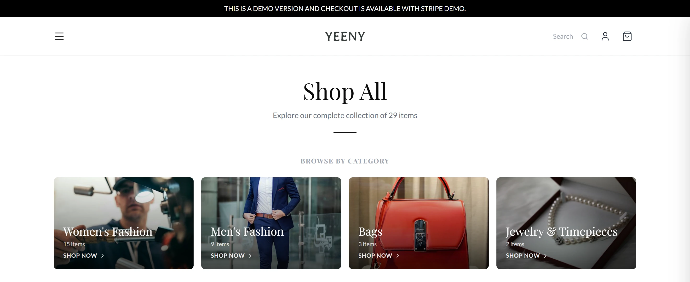
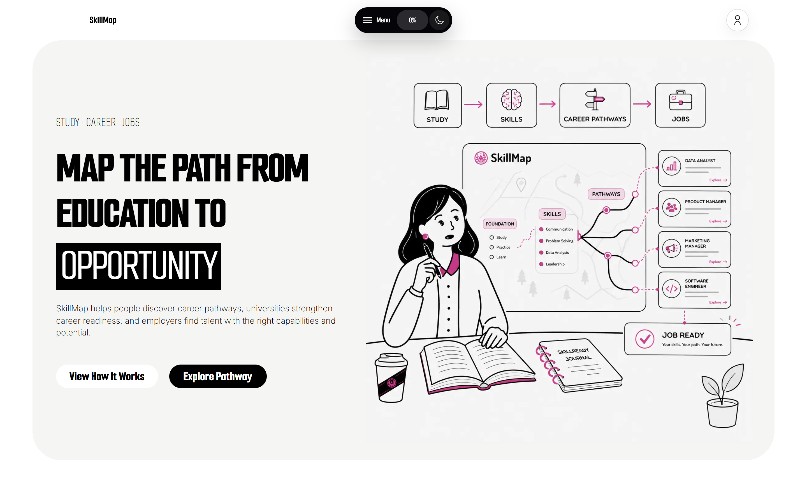
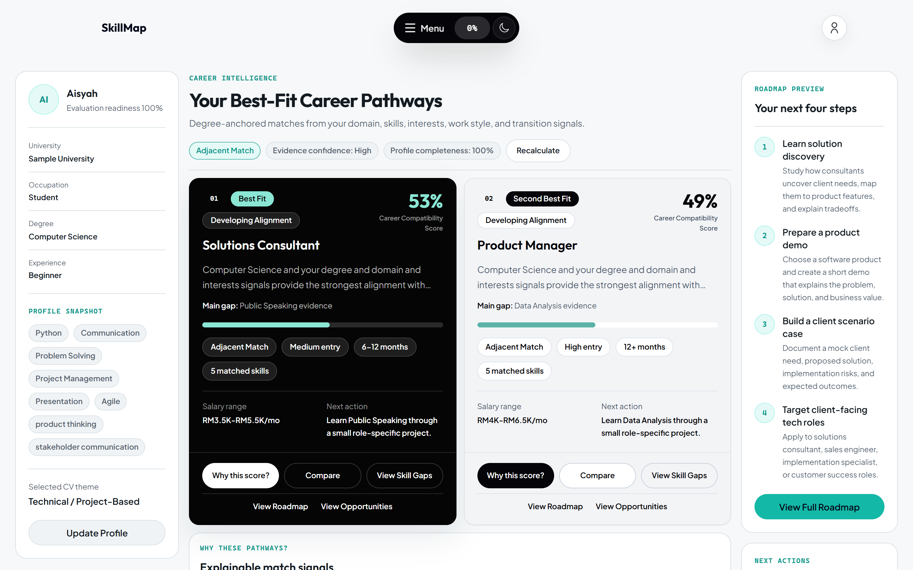
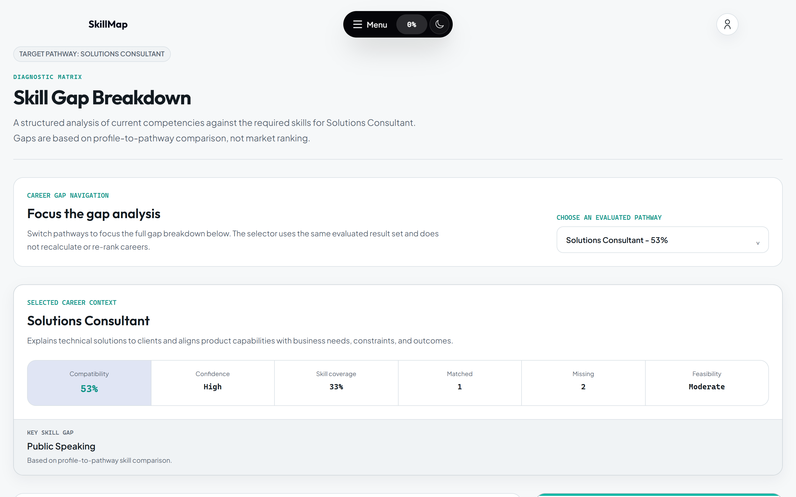
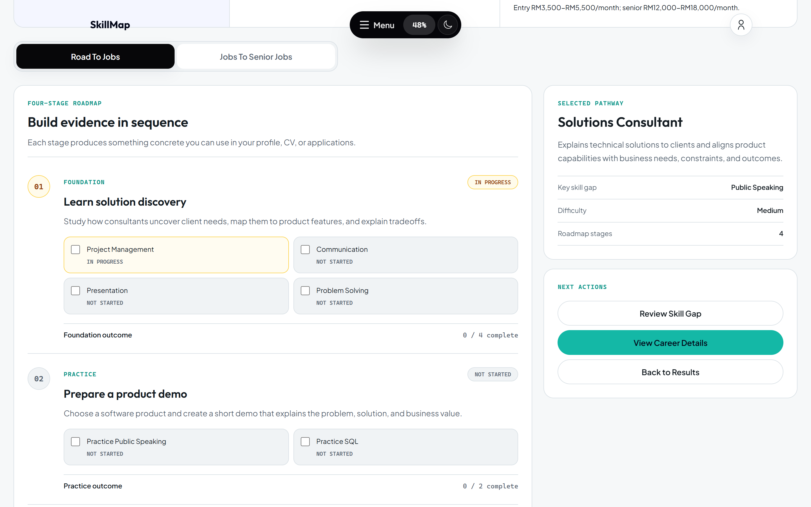
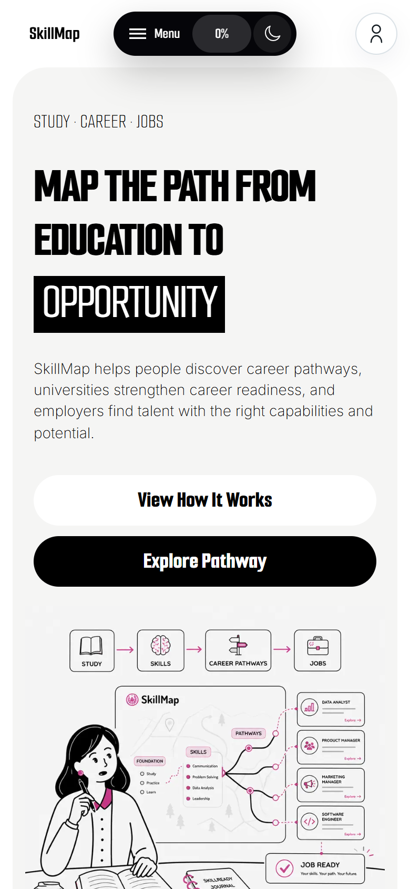

# Project Portfolio

**Ian Lee · Computer Science Student**

I’m interested in web application development, product design, and practical problem solving. These projects explore how clear interfaces and working product flows turn an idea into something people can use.

| Project | Product focus | Explore |
| --- | --- | --- |
| **YEENY V2** | Fashion commerce | [Live demo](https://yeeny-v2.vercel.app/) · [Project notes](000-Yeeny_Fashion/README.md) |
| **SkillMap** | Education and career planning | [Live demo](https://talentbank-hackathon-yeeny.vercel.app/) · [Project notes](001-SkillMap/README.md) |

## Featured Projects

### YEENY Fashion — V2

A fashion e-commerce demo that connects collection-led browsing, product selection, and a shopping bag.

**[Explore the storefront](https://yeeny-v2.vercel.app/) · [Read the project notes](000-Yeeny_Fashion/README.md)**

Independent fashion brands need a storefront that communicates their identity while helping shoppers find and select products. YEENY combines campaign imagery with category browsing and a direct product-to-bag journey. The implementation connects an editorial homepage to practical shopping controls.

**Features explored in the live demo**

- Promotional and collection entry points on the homepage.
- A catalog organized into women’s fashion, men’s fashion, bags, and jewelry/timepieces.
- Category selection, price filtering, and product sorting.
- Product details with pricing, size selection, availability text, and a size-guide link.
- Adding a selected size to the shopping bag and displaying the item count and subtotal.
- Desktop and mobile landing layouts with navigation, search, account, and bag controls.

**Technology:** Next.js and React are evidenced by the deployed application. The project notes document TypeScript, Tailwind CSS, Firebase Authentication, and Cloud Firestore across its implementations. Hosting: Vercel. Exact dependency versions are not available here.

**Project credit:** The existing documentation attributes YEENY Fashion to **YEENY Studio**. It also describes merchant catalog, inventory, and order-management workflows; those administrative workflows were not verified in this public walkthrough.

**Demo status:** The site advertises Stripe demo checkout; no payment was submitted. During the 14 October 2026 review, product-image requests returned HTTP 502 after retry. These screenshots show the working hero and category artwork; product-detail and catalog-grid captures were excluded.

View the category overview and mobile storefront

**Shop All — category overview.** A cropped desktop viewport showing the working category navigation above the product grid.

**Mobile storefront — 390 × 844 viewport.**

### SkillMap

A career-planning prototype that helps students and working professionals connect their education, skills, and interests to career options and practical next steps.

**[Explore SkillMap](https://talentbank-hackathon-yeeny.vercel.app/) · [Read the project notes](001-SkillMap/README.md)**

Career exploration often separates the question “What fits me?” from “What should I work on next?” SkillMap brings profile intake, compatibility explanations, skill gaps, and a roadmap into one candidate journey. Its public landing page also introduces employer and university perspectives on recruitment and career readiness.

Try the public demo without creating an account: select **Explore Pathway → Higher Education → Continue**, load a built-in **Sample Profile**, and choose **Evaluate Career**. The screenshots use the application’s **Aisyah** sample and its generated results, with no manually invented scores or profile data.

**Features explored in the live demo**

- Stage selection for secondary school, higher education, and working professionals, plus stage-specific public pathway previews.
- Structured profile intake for education, skills, interests, experience, and work preferences, with built-in examples.
- Ranked career compatibility results with explanations, confidence indicators, and side-by-side comparison dimensions.
- Skill-gap analysis showing transferable strengths, required skills, missing skills, and transition signals for a selected pathway.
- A four-stage roadmap covering foundation, practice, portfolio work, and entry-role preparation.
- A browser-local guest journey; the interface identifies account requirements for cross-device saving and application-related features.

**Sample evaluation — career compatibility and next steps**

**Technology:** Next.js and React are evidenced by the deployed application. The documentation identifies TypeScript, Tailwind CSS, Next.js server actions/API routes, and Supabase PostgreSQL and Authentication. Hosting: Vercel. Backend authorization and cloud persistence were not audited here.

**Project credit:** **Ian Lee** is the named author in the existing SkillMap documentation. The project is a hackathon prototype; individual team responsibilities are not specified.

**Demo status:** Compatibility is decision support, not an employment prediction or a live labour-market forecast. Sample scores, salary ranges, and institutional previews are illustrative. The roadmap says senior-career milestones are not yet modeled. Employer and university account workflows were not exercised.

View skill-gap analysis, the roadmap, and the mobile landing page

**Skill-gap analysis — the same sample and selected career.**

**Roadmap — preparation stages for Solutions Consultant.**

**Mobile landing page — 390 × 844 viewport.**

## Technology & Engineering Focus

| Area | Technologies or demonstrated work | Evidence |
| --- | --- | --- |
| Web interfaces | Next.js, React | Deployed application assets and project documentation |
| Languages and styling | TypeScript, JavaScript, Tailwind CSS | Project documentation; source manifests are not included here |
| Application services | Firebase Authentication and Firestore for YEENY; Supabase PostgreSQL and Authentication for SkillMap | Documented stacks; backend behavior requires separate verification |
| Deployment | Vercel | Both linked live deployments |
| Product experience | Responsive landing pages, shopping interactions, profile intake, explainable results, and development roadmaps | Public browser walkthrough and authentic screenshots |

## About This Repository

This is a **portfolio and documentation hub**, not the application source checkout. The linked project notes retain broader architecture, product scope, and development plans; their setup examples require the corresponding application source. No application-source repository link has been supplied or independently verified.

Screenshots were captured from the live sites in Chrome on **14 October 2026**, using **1440 × 900 desktop** and **390 × 844 mobile** viewports at 2× scale. They are optimized WebP files, with no substituted UI, fabricated results, or generated imagery. See the [capture notes and verification boundaries](assets/screenshots/README.md) for routes, reproduction steps, and known limitations.

## Connect

[GitHub — Ian3556](https://github.com/Ian3556) · [Portfolio repository](https://github.com/Ian3556/Projects-Portfolio)
